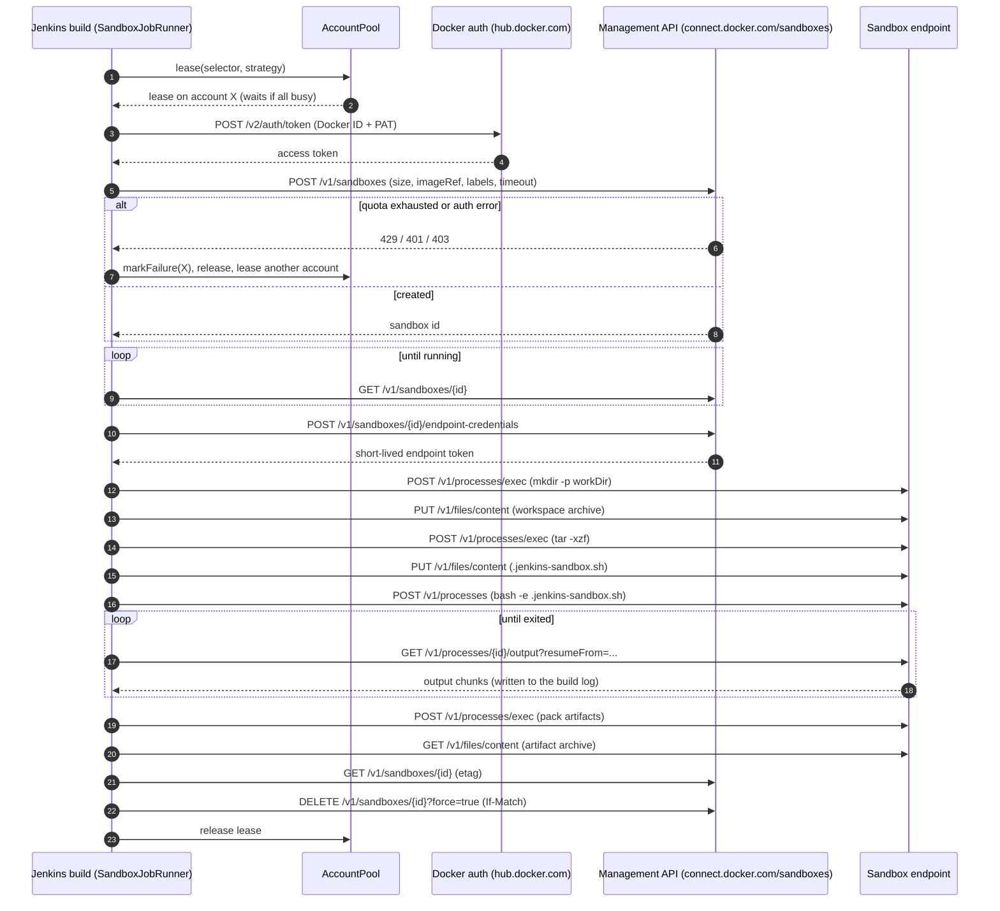

# Architecture

## Components

All code is in the package `io.jenkins.plugins.dockersandbox` (`src/main/java/...`).

| Component | Location | Responsibility |
| --- | --- | --- |
| API clients | `api/` | `DockerSandboxApi` / `HttpDockerSandboxApi` (management API: create, get, list, delete sandboxes, endpoint credentials), `SandboxEndpointApi` / `HttpSandboxEndpointApi` (per-sandbox endpoint: exec, processes, signals, file upload/download), `TokenProvider` (PAT exchange and token cache), `HttpCaller` (bearer auth, one refresh on 401, bounded retries on 429/502/503/504 honoring `Retry-After`), `SandboxApiException` (error mapping). `api/model/` holds the JSON records |
| Accounts | `account/` | `SandboxAccount` (one Docker account), `AccountPool` (leases and capacity under a single lock), `AccountSelector` (pin/labels/exclusions), `LoadBalancingStrategy`, `AccountState` (in-memory counters and cooldown), `AccountApiFactory` (credentials lookup, token provider cache, connection test) |
| Global configuration | `DockerSandboxGlobalConfiguration` | *Manage Jenkins > System* form, defaults, instance id; owns the `AccountPool` |
| Runner | `SandboxJobRunner` | The whole run: lease, create, wait, upload, execute, stream, artifacts, delete. Shared by the step and the builder |
| Run description | `SandboxRunSpec`, `SandboxSize`, `SandboxRunResult` | Normalized options, named sizes, the value returned by the step |
| Pipeline step | `SandboxRunStep` | `sandboxRun`, a synchronous non-blocking step execution |
| Freestyle builder | `SandboxBuilder` | *Run script in Docker Cloud Sandbox* build step (`sandboxBuild`) |
| Orphan cleanup | `OrphanSandboxCleanup` | `AsyncPeriodicWork`, every 10 minutes |
| Management page | `DockerSandboxManagementLink` | *Manage Jenkins > Docker Cloud Sandboxes* with live usage and connection test |
| Backend seam | `SandboxBackend` | Factory for the two API clients; tests replace it with the WireMock-backed fake |

## Run sequence

1. **Validate** the options (non-blank script, workspace available, valid `env` entries, absolute `workDir`, known size).
2. **Lease** an account from the `AccountPool` using the configured strategy (waits when all matching accounts are
   busy). The lease is released on every path (try-with-resources).
3. **Create the sandbox** on the management API: display name `jk-<job>-<build>` (max 64 characters), size, image (kit template or custom image),
   labels and a lifetime via `features.timeouts` (`<ttl>s`, `onTimeout: delete`). An `Idempotency-Key` header is sent.
   Quota or authentication errors put the account in cooldown and the loop continues with another account.
4. **Wait** until the sandbox is `running` and has an endpoint URI (polls every 2 s, gives up after 5 minutes, fails
   early if the sandbox reports `failed`, `stopped`, `stopping` or `deleting`).
5. **Open the endpoint** and obtain a short-lived endpoint credential (permissions `sandboxesExec`,
   `sandboxesFilesRead`, `sandboxesFilesWrite`, TTL 300 s, renewed 30 s before expiry or after a 401).
6. `mkdir -p <workDir>`.
7. **Upload the workspace**: Jenkins archives the workspace (`includes`/`excludes`) into a `tar.gz` with a size limit,
   uploads it to `/tmp/jenkins-ws.tgz`, then runs `tar -xzf ... -C <workDir>` in the sandbox.
8. **Write the script** to `<workDir>/.jenkins-sandbox.sh` (mode 0755) and **start** `bash -e .jenkins-sandbox.sh` as a
   process with the build's `env` and `workDir`.
9. **Stream the output** by polling the process output (300 ms, backing off up to 2 s while idle) until the process
   exits or the timeout is reached (TERM, a grace period, then KILL).
10. **Fetch artifacts**: a `bash` command with `globstar nullglob` expands the patterns and packs the files into
    `/tmp/jenkins-out.tgz`; Jenkins downloads and extracts it into the workspace.
11. **Delete the sandbox** (up to 3 attempts) unless `keepSandbox` is set, then release the lease.

If the build is aborted, the process receives `kill` and the sandbox is still deleted. If deletion fails the build log
says so and the [orphan cleanup](configuration.md#orphan-cleanup) retries later.

## Security model

* **Secrets stay in Jenkins credentials.** The PAT is read from a *Username with password* credential at run time.
  The `TokenProvider` exchanges it for a short-lived access token and prints as `secret=****` in `toString()`.
* **Masking.** Every message the plugin writes to the build log and every failure shown on the management page passes
  through a masker that replaces strings that look like Docker PATs (`dckr_pat_...`), `Bearer` tokens and JWTs with
  `****`. API errors are reduced to the HTTP status, the error code and a truncated message (max 300 characters);
  `SandboxApiException` is documented as never carrying secrets, which also covers the *Test connection* button in the account form.
* **No secrets in sandbox metadata.** Sandbox labels contain only the Jenkins instance id, the (sanitized) job name,
  build number, an encoded run id and the account id. The build `env` is passed to the script process only; the
  create-time `environment` field of the API is not used.
* **Least privilege for the endpoint.** The endpoint credential is limited to exec and file read/write, valid for at most
  5 minutes and renewed automatically.
* **Cleanup guarantees.** The sandbox is deleted and the slot released on success, script failure, timeout, abort and
  start failures. The orphan cleanup only deletes sandboxes labeled with this instance's id, older than 15 minutes,
  whose build is over, and never ones labeled `jenkins-keep`.
* **Admin-only operations.** Connection tests and the management page require the Administer permission; test
  endpoints are POST-only. Credentials in the form are filtered by the permission of the user.
* **Script content.** The script and `env` values travel to the sandbox over HTTPS and are visible to code running
  there. The sandbox is isolated from the Jenkins agent, but anything you upload (the workspace) or pass is available
  to the script; use `excludes` for files that must not leave Jenkins.

Report vulnerabilities as described in [SECURITY.md](../SECURITY.md).

## Deviations from the spec and unverified assumptions

The OpenAPI spec (`src/test/resources/openapi/sandboxes-api.yaml`) is the source of truth for API shapes. Where the
original plan and the spec differ, the spec was followed:

* `DELETE /v1/sandboxes/{id}` requires an `If-Match` etag (428 without, 412 when stale). The client reads the current
  etag first and retries once on 412 or 428.
* Signals are `POST /v1/processes/{id}/signal` with body `{"signal":"term"}` (`term`, `kill`, ...).
* Error codes are camelCase in the spec (`resourceExhausted`); they are matched case-insensitively and ignoring
  underscores, so `RESOURCE_EXHAUSTED` works too.
* The sandbox lifetime is requested with `features.timeouts` (`timeout: "3600s"`, `onTimeout: "delete"`).
* Kits are launched as their template image, `imageRef: docker/sandbox-templates:<kit>`, without `kits` and without a
  start command. Sending a kit by name only (`kits[].artifact.ref`) is rejected by the live API (HTTP 400,
  `kits[0].artifact.source` required); see [Troubleshooting](troubleshooting.md#kit-rejected-by-the-service-fixed-after-100).
* Verified against the live service (Nov 2026): token exchange, list, create (template image and raw `ubuntu:24.04` with
  `startupExecution`), endpoint credential, exec, file upload/download, process start/output/exit code, delete. The
  sandbox GET may omit the `ETag` header; the plugin falls back to `core.etag`. `exitCode` is omitted when it is 0.
* Endpoint credentials use `ttl: "300s"`; permissions are `sandboxesExec`, `sandboxesFilesRead`, `sandboxesFilesWrite`.
* `networkPolicies` are not sent.
* The spec has no description of the Docker token exchange. The plugin uses `POST <authUrl>/v2/auth/token`
  (`{"identifier","secret"}` -> `access_token`, falling back to a `token` field) as documented for Docker Hub.
  Verified against the live service: the token carries scope `sandbox:use`.
* The account pool belongs to the global configuration instead of being a separate extension; state is keyed by account
  id so it survives configuration saves.
* The whole project is tested against a stateful fake, never against the live service (see
  [development](development.md#test-strategy)).
